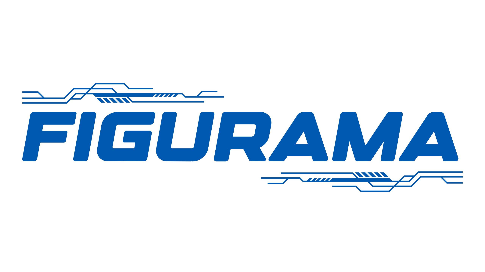

  

<h3 align="center">
  <b>Autores: Kevin Alemanno, Alejandro Decurgez, Daiana Diaz</b>
</h3>

¡Bienvenido a **Figurama**! Un juego de tablero digital donde la astucia, los patrones geométricos y los mitos clásicos se cruzan. Tu objetivo principal es formar en el tablero las figuras geométricas exactas que indican tus **Cartas de Figura** (usando 4 o 5 fichas) mediante el movimiento de fichas en la grilla. ¡Usa tus **Cartas de Movimiento**, aprovecha la habilidad única de tu personaje legendario y completa todas tus figuras antes que tus rivales para consagrarte con la victoria!

---

## 🎮 Mecánicas Principales y Reglas de Juego

### 🔄 El Turno de Juego (Paso a Paso)
1. **Robo de Mano:** Al comenzar tu turno, recibes tus cartas de movimiento y tus cartas de figuras a armar.
2. **Planificación:** Revisa tus Cartas de Figura objetivo. Observa el tablero y busca qué fichas necesitas mover para replicar la forma exacta (horizontal, vertical o rotada).
3. **Ejecución de Movimientos:**
   - Haz clic en una Carta de Movimiento (ej. intercambiar fichas, desplazar, etc.).
   - Ejecuta la acción en el tablero seleccionando las fichas indicadas.
   - La carta utilizada se volteará automáticamente mostrando su dorso.
4. **Uso de Habilidad Única:** Si el botón de habilidad está activo y se cumplen las condiciones, presiónalo para activar el poder especial de tu personaje (**Lobizón**, **Pomberito**, **Luz Mala** o **Mulánima**). Al usarse, la habilidad quedará marcada como usada y deberá recargarse según las reglas.
5. **Validación Automática:** El juego detecta en tiempo real si las fichas en el tablero forman una de tus figuras asignadas. Al completarse, la figura pasa a estado completado (resaltado verde) y suma puntos al marcador.

### 🧩 Las Cartas y Formas
- **Figuras de 4 Fichas:** Formas compactas como la **L4** (en sus variantes izquierda/derecha) o la **Línea 4**.
- **Figuras de 5 Fichas:** Formas más complejas como la **Cruz**, la **L5** (en sus variantes quirales izquierda/derecha) y la **Zig-Zag**.
- **Rotación y Espejo:** Las figuras pueden requerir una orientación específica según las matrices de rotación permitidas.

---

## 🖥️ Interfaz de Usuario (HUD)

- **Tablero de Juego (Grid):** Tablero central con fichas de colores donde realizarás los desplazamientos e intercambios, visión con cámara superior e inclinada (3D).
- **Panel de Cartas de Figuras (Izquierda Inferior):** Muestra las figuras que debes armar:
  - **Borde / Tono Normal:** Figura pendiente por completar.
  - **Resaltado Verde:** ¡Figura completada con éxito!
- **Mano de Cartas de Movimiento (Derecha Inferior):** Muestra tus cartas de acción disponibles en el turno actual:
  - **Frente visible:** Carta disponible para usar.
  - **Dorso / Volteada:** Carta consumida en este turno.
- **Botón de Reroll:** Permite descartar tu mano actual de movimientos para obtener cartas nuevas en el próximo turno, finalizando el turno de inmediato y perdiendo la acción del actual. Solo se puede tocar si no moviste fichas este turno; si usas una carta de movimiento, este botón se desactiva sin posibilidad de uso.
- **Botón de Habilidad Especial:** Muestra la imagen de tu personaje. Si cumples los requisitos de activación, se ilumina para desatar su poder; si ya la usaste o no está disponible, cambiará a su estado desactivado.
- **Marcador de Puntuación (`PuntuaciónView`):** Muestra el conteo de figuras armadas.
- **Timer:** Temporizador con cuenta regresiva ubicado en la zona superior central para una lectura más ágil.
- **Visualización de Jugador Actual:** Cambia el fondo según el jugador activo y muestra en la esquina superior izquierda su nombre junto al personaje elegido.
- **Menú Principal:** Acceso a **Tutorial / Cómo Jugar** (slides divididos en elementos y flujo de juego) y **Jugar** (configuración de partida, elección de personaje con descripción y nombre de usuario).

---

## 🎯 Diseño de Juego (MDA)

### ⚙️ Mecánicas
1. Elegir la dificultad del juego (**Fácil**, **Mediano**, **Difícil**).
2. Elegir la cantidad de jugadores (**1 a 4**).
3. Elegir los nombres de cada jugador.
4. Elegir el personaje de cada jugador (véase los power-ups).
5. **Click izquierdo** para interactuar con objetos y elementos de UI.
6. Cartas para seleccionar el movimiento a hacer (cada jugador recibe la misma cantidad y esta depende de la dificultad de la partida).
7. Seleccionar 2 fichas para intercambiar sus lugares (dependiendo de la carta de movimiento seleccionada). El tablero contiene **36 fichas de 4 colores** con cantidades equitativas.
8. Botón para finalizar el turno del jugador actual y pasar al siguiente (se activa luego del primer movimiento este turno). Si ya no quedan jugadores se vuelve al primero, quien tendrá las cartas que no haya usado y nuevas para completar su mano.
9. Botón de **Reroll**: el próximo turno de este jugador tendrá cartas de movimiento completamente nuevas (solo se puede tocar si no movió fichas este turno; inmediatamente termina su turno y pasa al siguiente jugador).
10. Condición de tiempo límite para cada turno.
11. Power-up seleccionable desde la UI, se puede usar una vez por jugador y luego tarda **2 rondas** en recargarse:
    - **Lobizón:** Transforma una ficha en un comodín que funciona como cualquier color durante su turno.
    - **Luz Mala:** Elige un jugador y en su próximo turno tendrá una carta de movimiento menos.
    - **El Pomberito:** Consigue una carta de movimiento extra este turno.
    - **Mulánima:** Elige una ficha para prender fuego; esta ficha no se puede mover hasta que sea el turno de Mulánima de nuevo.
12. Completar figuras en el tablero poniendo fichas del mismo color juntas sin que sobre ninguna (las figuras a completar se asignan aleatoriamente a cada jugador al inicio de la partida).
13. Luego de completar una figura, se guarda el último color usado y la próxima figura formada no podrá ser de ese color, deberá ser de otro color.
14. La condición de victoria es que un jugador complete todas sus figuras; el primero en lograrlo gana.

### 🔀 Dinámicas
1. Los jugadores deben medir el riesgo de rerollear sus cartas, perdiendo el turno por la chance de recibir mejores cartas en el próximo.
2. Los jugadores pueden terminar su turno temprano si consideran que moviendo más fichas podrían estar ayudando a sus rivales.
3. Los jugadores deben tener en cuenta el último color usado para no formar figuras con el mismo color; de esa misma forma también se puede perjudicar a otros.
4. Cada jugador debe elegir un personaje para estrategizar con su power-up y también tomar en cuenta los personajes de los rivales.
5. Los jugadores deben estrategizar rápidamente para no quedarse sin tiempo.
6. Los jugadores deben encadenar movimientos en un mismo turno para formar figuras, teniendo en cuenta las limitaciones de sus movimientos y el estado actual del tablero.
7. Los jugadores deben tener en cuenta todas las figuras que tienen asignadas para decidir cuál sería mejor completar primero en base a la posición de las fichas y sus movimientos en este turno y prediciendo los próximos también.
8. Los jugadores deben tener en cuenta el orden de los turnos y cuántas rondas faltan para cargar sus power-ups y los de sus rivales.

### ✨ Estéticas
1. Estrategia y toma de decisiones con recursos limitados.
2. Predicción y tomar chances con posibles recompensas.
3. Improvisación y pensamiento rápido.
4. Expresión en estilo de juego y customización.
5. Competencia mental contra otras personas.

---

## 🛠️ Justificación de Patrones

### 🧩 Patrón de Diseño Elegido: Command
Para el desarrollo de **Figurama** (basado en la mecánica del juego *Switcher*), elegimos implementar el patrón de diseño **Command** como eje central de la arquitectura de jugabilidad.

- **¿Por qué elegimos Command?** En este juego, la interacción del usuario con el tablero no se reduce a mover fichas de forma libre: cada acción está estrictamente delimitada por las cartas de movimiento que el jugador tiene en la mano. El patrón Command encaja de manera ideal porque encapsula cada tipo de movimiento como un objeto independiente. En lugar de tener un `Controller` sobrecargado con múltiples condicionales o `switch` evaluando reglas, cada carta (`CartaMovimiento`) se transforma en un comando autónomo que sabe cómo validarse (`EsValido`) y cómo aplicarse sobre la matriz del tablero (`Ejecutar`).
- **¿Dónde lo implementamos en la arquitectura?**
  - **Command:** La clase base o interfaz `CartaMovimiento`, que define el contrato estándar para cualquier tipo de desplazamiento sobre la grilla.
  - **ConcreteCommands:** Las distintas clases derivadas de `CartaMovimiento` (como desplazamientos diagonales, saltos o intercambios adyacentes), cada una con su lógica matemática y reglas específicas.
  - **Invoker:** El `Controller` y el `Tablero`, que reciben la solicitud del usuario, retienen el `movimientoActual` seleccionado y le ordenan su ejecución sin conocer los detalles internos de la regla.
  - **Receiver:** El modelo de datos del tablero (`TableroReglas`), sobre el cual el comando altera el estado de las fichas y las posiciones.
- **¿Qué problemas nos resuelve dentro del juego?**
  - **Desacoplamiento total:** El controlador y la interfaz visual (`Tablero.cs`) no necesitan saber cómo funciona internamente cada carta de movimiento; únicamente invocan `movimientoActual.Ejecutar(...)`.
  - **Escalabilidad y extensibilidad (Open/Closed):** Agregar nuevas cartas con reglas más complejas consiste en crear una nueva clase derivada de `CartaMovimiento` sin modificar el motor principal del juego.
  - **Control e historial de jugadas:** Al tratar cada movimiento como un objeto, es sencillo registrarlos mediante `RegistrarMovimientoRealizado`, dejando lista la base para historial, *Replay* o *Undo*.

---

## 🌐 Adaptación a Red (Resumen)

| Eje | Detalles Clave |
| :--- | :--- |
| **Arquitectura y Transporte** | Cliente-servidor con **servidor autoritativo** en Godot 4 (C#) sobre `MultiplayerApi` / `ENetMultiplayerPeer`. El host corre en la PC del anfitrión (peer `1`) y participa como jugador; los envíos usan `RpcId` / `RPC`, `Red` verifica conexión/rol y al volver al menú principal se cierra el peer y se asigna `OfflineMultiplayerPeer`. `PartidaSnapshot` y `List<EventoRed>` se serializan a JSON (`System.Text.Json`). La UI se divide en `JugadorMP` o `EspectadorMP`, y los clientes pueden prepararse como réplica pasiva (`PrepararReplica`). |
| **Responsabilidades del Servidor** | En `TableroMP` y `ControllerRed`: espera `ClienteListo`, genera colores (`_gestorFichas.GenerarIndicesColores()`), crea el tablero (`CrearTablero`) y soporta *late-join* (`EnviarTableroA`). Valida turno y acciones (`ValidarTurno`, `ValidarMovimiento`, `ValidarHabilidad`, reroll y cierre de turno), ejecuta reglas y turnos, controla el reloj y ausencias en `_Process` (`RecibirTiempo`, eventos de `GestorSala` con corte si quedan `< 2` activos) y exporta/envía estado y eventos (`ExportarEstado`, `ConstruirSnapshot`, `EnviarResultado`). |
| **RPCs y Eventos** | **Cliente -> Servidor (`RpcId(1, ...)`):** `ClienteListo`, `PedirMovimiento`, `PedirHabilidad`, `PedirReroll`, `PedirFinTurno`. **Servidor -> Clientes:** `CrearTablero`, `RecibirRespuesta`, `RecibirResultado`, `RecibirTiempo`, `RecibirFinPartida`. Los eventos del servidor se encolan como `EventoRed` (`_eventosPendientes`) para disparar eventos locales y señales de UI en los clientes; el reloj visual avanza suavemente con `DescontarTiempoVisual(delta)`. |
| **Datos Sincronizados** | `PartidaSnapshot` (turno, último color, movimientos usados, fin de partida, transición, tiempo restante), `JugadorSnapshot` (nombre, personaje, enfriamientos, reroll, acción realizada, eliminado, puntuación, vueltas, cartas a quitar, extras, ficha comodín), manos/figuras/bloqueos, `FichaSnapshot` y colores iniciales, más `EventoRed` (tipo, datos enteros y texto). |
| **Salas, Descubrimiento y Reconexión** | **UDP Broadcast:** `SalaInfo` en JSON cada 1s a `127.0.0.1` y `255.255.255.255` (puertos `7800–7809`); el lobby descarta salas inactivas `> 3s`. Cupos: hasta **4 jugadores** y **2 espectadores** (máx. 5 clientes remotos en `GestorSala`). Token `Guid` en memoria (`DatosPartida.TokenLocal`) enviado al host (`DatosPartida.TokensJugadores`); en anuncios públicos se difunde su huella SHA-256 (16 hex). Si se desconecta, se reserva el lugar **60s** (`SegundosParaVolver`) pausando el reloj si tenía el turno y permitiendo reconectar con `Identificarse`. |
| **Decisiones y Limitaciones** | Sin servidor dedicado (depende del host). Servidor siempre autoritativo (clientes solo resaltan jugadas válidas). Funciona en red local (requiere abrir puertos UDP `7777–7786` y `7800–7809` en firewall). Tráfico ENet sin cifrado (requeriría p. ej. DTLS fuera de red confiable). Reconexión limitada a 60s y sin cierre del juego (token en memoria). |

---

## 📄 Documentación Técnica

- [Documento Técnico Figurama Local/HotSeat](https://docs.google.com/document/d/1bJNM056d6-P9cfpTCB3ImmbCYZXrp_qQbvZtp-u7Ojg/edit?tab=t.0)
- [Documento Técnico Figurama Online Multiplayer](https://docs.google.com/document/d/1bJNM056d6-P9cfpTCB3ImmbCYZXrp_qQbvZtp-u7Ojg/edit?tab=t.0)
- [Backlog del Team - Solicitar Acceso](https://trello.com/b/4fImJX05/figurama-backlog)
